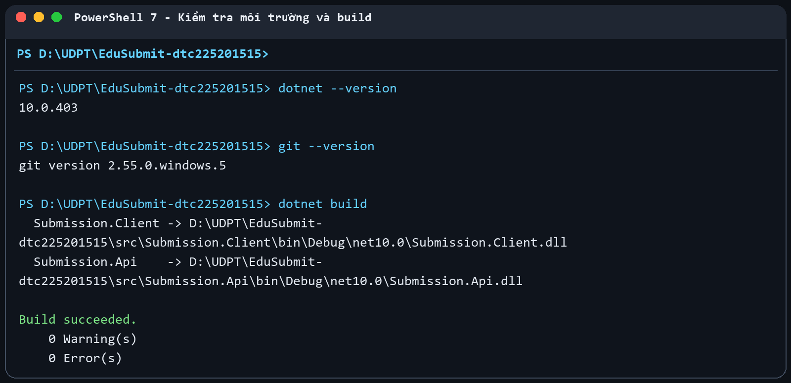
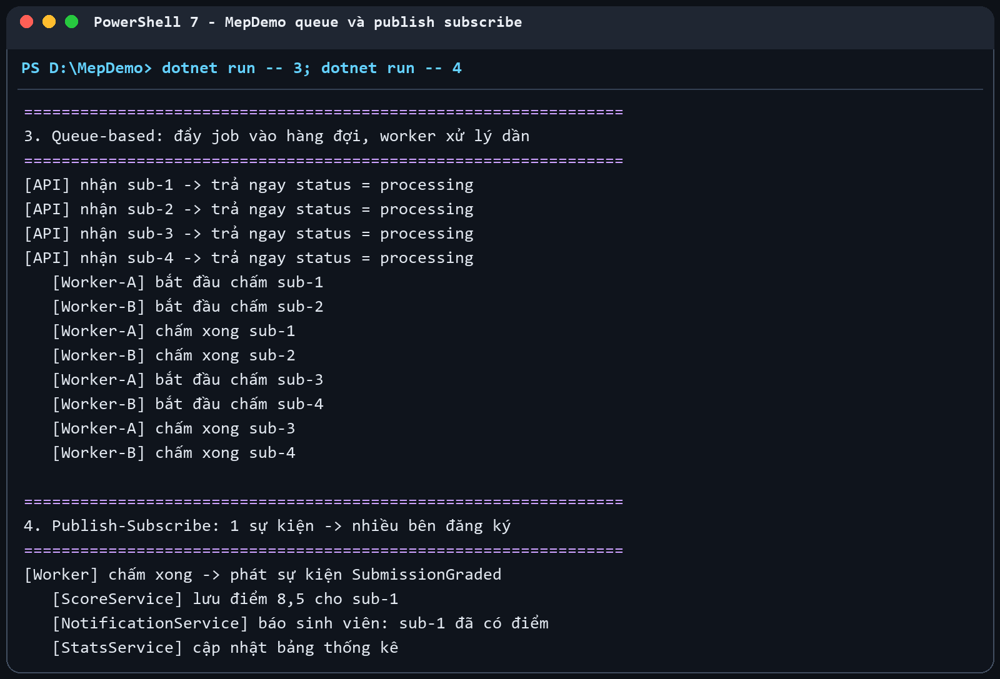
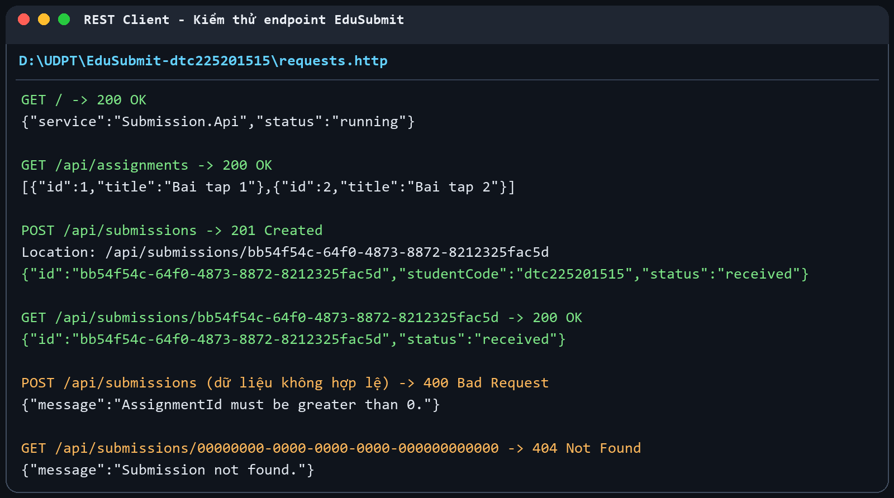
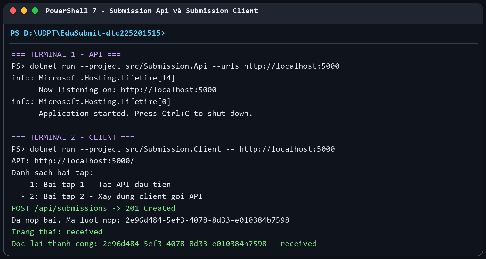
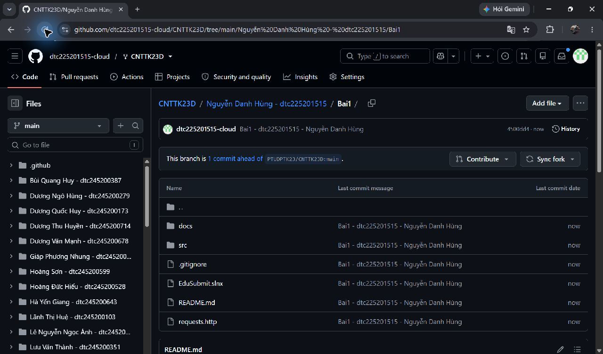

# Bài 1 Tổng quan hệ thống và MEP

- Họ tên: Nguyễn Danh Hùng
- MSSV: dtc225201515
- Lớp: CNTT K23D
- GitHub: https://github.com/dtc225201515-cloud

## 1. Cài đặt

Máy đã cài .NET SDK 10.0.403 và Git 2.55.0. Dự án build thành công trên .NET 10.



## 2. MepDemo Bước 7

1. Ở MEP 3, mỗi bài nộp `sub-x` chỉ được một worker xử lý. Hai worker là các competing consumers và chia nhau công việc trong cùng hàng đợi.
2. Ở MEP 4, một sự kiện `SubmissionGraded` được gửi tới cả ba dịch vụ: ScoreService, NotificationService và StatsService.
3. Mô tả năm MEP:
   - Request-response: bên gửi tạo yêu cầu và chờ đúng một phản hồi hoặc xử lý timeout.
   - One-way: bên gửi chuyển thông điệp rồi tiếp tục công việc, không chờ kết quả nghiệp vụ.
   - Queue-based: công việc được đưa vào hàng đợi và mỗi công việc chỉ do một worker cạnh tranh nhận xử lý.
   - Publish-subscribe: một sự kiện được phát cho tất cả bên đăng ký độc lập.
   - Streaming-push: máy chủ chủ động gửi nhiều cập nhật liên tục trên một luồng kết nối.



## 3. BasicWebApi Bước 8

Ảnh kiểm thử các mã trạng thái HTTP tương ứng 200, 201 và 400 được ghi lại khi thử API.



Trả lời mục 8.4:

1. `builder.Services.AddSingleton(...)` phải đứng trước `builder.Build()` vì các dịch vụ phải được đăng ký trước khi DI container của ứng dụng được tạo.
2. Trong `/hello/{name}?language=en`, `name` lấy từ route và `language` lấy từ query string.
3. POST hợp lệ trả 201 Created vì yêu cầu đã tạo một tài nguyên mới; phản hồi có thể kèm header `Location` chỉ đến tài nguyên đó. 200 OK chỉ cho biết yêu cầu thành công nói chung.

## 4. MiniDistributedSystem Bước 9

Client gọi `GET /api/assignments` và `POST /api/submissions`. GET hợp lệ trả 200; POST hợp lệ trả 201 cùng dữ liệu lượt nộp. Ở phần mở rộng, client gọi thêm `GET /api/submissions/{id}` và nhận 200 nếu tìm thấy hoặc 404 nếu không có.

Client không tham chiếu hoặc dùng chung code của API. Hai tiến trình thống nhất với nhau bằng hợp đồng HTTP gồm method, URL, mã trạng thái và cấu trúc JSON.

Địa chỉ API được truyền qua tham số để client có thể chạy với nhiều cổng hoặc môi trường mà không phải sửa rồi biên dịch lại code.



## 5. Thí nghiệm lỗi Bước 10

| # | Dự đoán | Thực tế | Đúng Sai | Giải thích |
| --- | --- | --- | --- | --- |
| a | Thêm bài tập thứ ba ở API thì client tự hiển thị thêm, không cần sửa code. | Client duyệt danh sách JSON trả về nên số phần tử thay đổi không làm đổi code client. | Đúng | Hợp đồng là một mảng `Assignment`; client không viết cứng số phần tử. |
| b | Tắt API rồi chạy client sẽ lỗi kết nối. | Xuất hiện `HttpRequestException` với thông báo không kết nối được đến máy chủ. | Đúng | Gọi qua mạng phụ thuộc tiến trình, địa chỉ và cổng; gọi hàm trong cùng chương trình không có các điểm lỗi mạng này. |
| c | Gửi `StudentCode` rỗng sẽ nhận 400. | API trả `400 Bad Request`; `EnsureSuccessStatusCode()` ném ngoại lệ với phản hồi không thành công. | Đúng | Máy chủ phải tự kiểm tra dữ liệu ở ranh giới tin cậy, không được dựa vào client. |
| d | API chạy cổng 5050 nhưng client gọi 5000 sẽ lỗi. | Client gọi 5000 thất bại; chạy lại với tham số `http://localhost:5050` thì thành công mà không sửa code. | Đúng | Địa chỉ máy chủ là cấu hình lúc chạy. |

## 6. Dự án EduSubmit tự làm Bước 11 và 12

Dự án gồm hai project độc lập `Submission.Api` và `Submission.Client`. API lưu các lượt nộp trong bộ nhớ, kiểm tra dữ liệu, tạo GUID và thời gian UTC, rồi trả 201 Created. Client lấy danh sách bài tập, tạo lượt nộp, kiểm tra mã trạng thái và đọc lại lượt nộp vừa tạo.

Không sao chép code project mẫu. Chỉ dùng đặc tả endpoint và khung record trong tài liệu để tự triển khai.

Luồng thông điệp:

```text
Client --(HTTP GET /api/assignments)--------> API : request-response
Client <--(200 + danh sách Assignment)------- API

Client --(HTTP POST /api/submissions)-------> API : request-response
Client <--(201 + SubmissionResult)------------ API

Client --(HTTP GET /api/submissions/{id})---> API : request-response
Client <--(200 + SubmissionResult hoặc 404)--- API
```

## 7. Khó khăn gặp phải và cách giải quyết

- Khi API chưa chạy hoặc client gọi sai cổng, client báo lỗi kết nối. Cách xử lý là đọc dòng `Now listening on`, chạy API trước và truyền đúng URL cho client.
- Dữ liệu không hợp lệ phải trả đúng 400 thay vì để chương trình lỗi. API kiểm tra `AssignmentId`, `StudentCode` và `RepositoryUrl` trước khi lưu.
- Lượt nộp phải đọc lại được. API lưu kết quả vào danh sách và tra cứu theo GUID; nếu không có thì trả 404.

## 8. Nộp bài

Bài được đặt trong `Nguyễn Danh Hùng - dtc225201515/Bai1` trên fork `dtc225201515-cloud/CNTTK23D`, không chứa thư mục `bin` hoặc `obj`. Pull Request dùng tiêu đề `Bai1 - dtc225201515 - Nguyễn Danh Hùng`.


